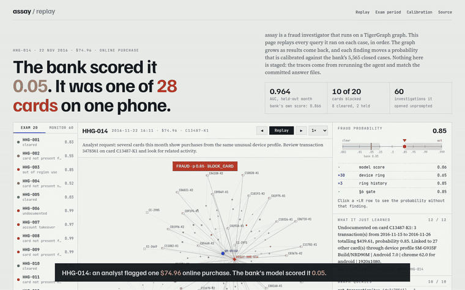
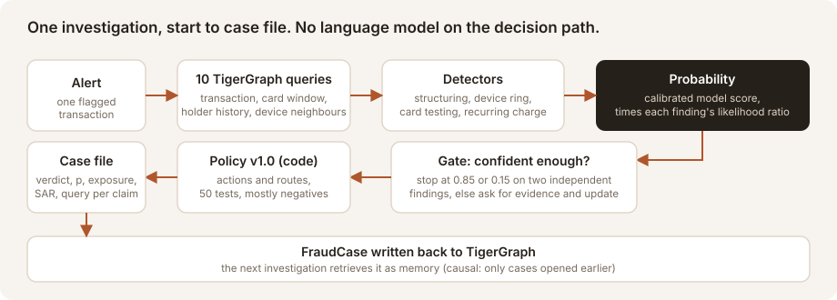

<div align="center">

# assay
### A fraud investigator whose probabilities are measured, not guessed.

[](https://github.com/nikhilcherry/assay/actions/workflows/tests.yml)   

**[Watch it think: live replay](https://nikhilcherry.github.io/assay/)** · [90-second story](https://nikhilcherry.github.io/assay/#story) · [Demo video (3:02)](https://github.com/nikhilcherry/assay/releases/download/replay-v1/demo.mp4)



<sub>Every frame is a real run, replayed query by query. Hacker House Goa 2026, Task 4 (TigerGraph x IEEE-CIS).</sub>

</div>

An alert goes in. A case file comes out: verdict, calibrated fraud probability, pattern, affected transactions, connected cards, exposure, the graph query behind every claim, a suspicious activity report when policy calls for one, and the next best action.

| | The bank's risk score | **assay** |
|---|---|---|
| AUC on a held-out month | 0.866 | **0.964** |
| Confirmed fraud caught (blind October, at 0.5) | 48.5% | **59.4%** |
| Alerts the bank's analysts had cleared, wrongly flagged | 100% | **4.9%** |

When assay says 0.30, about three in ten of those transactions were fraud. The reliability table on the held-out month tracks the diagonal from 0.005 to 0.77.

## Final round (HHF-001 … HHF-018)

```bash
docker --context default start assay-tg     # TigerGraph 4.2 CE, then: gadmin start all
ASSAY_TG=1 python -m assay.r2.agent HHF-007 --out cases_r2   # one case: exit 0 answer, 2 invalid input, 3 tool failed
make grade                                  # official grader, with --transactions
ASSAY_TG=1 python -m assay.r2.console --port 8742            # the demo console
```

| what | result | check it |
|---|---|---|
| Official grader (hard + policy, with ID and arithmetic checks) | **18/18 clean** | `make grade` |
| Verdicts | 6 fraud, 2 uncertain, 10 legitimate | `docs/r2/FACTS.md` |
| Live resilience drills | **75/75** checks on HHF-003, 007, 012 | `pytest tests/r2/test_drills.py` |
| TigerGraph on the decision path | rings from `r2_ring_wcc`, cases upserted as `FraudCase`; 18/18 ring decisions match the local code | `tg_r2.parity()` |
| Dispute episodes on 4,631 Jul–Oct reports | 0.6372 exact match (flagged-only 0.5498) | `docs/r2/N7_dispute_episode.md` |
| Red team: 10 Argon attackers, 80 blind scenarios | findings fixed; no prompt injection changed a verdict | `docs/r2/REDTEAM.md` |
| LLM tokens on the decision path | **0** | every answer's `tokens` |

Every answer in `cases_r2/` is the output of the single-case command above, run in its own process
(`make all`), so the console, the command and the files agree. The idea we want judged is in
[`docs/r2/INNOVATION.md`](docs/r2/INNOVATION.md), the boundary in [`docs/r2/RESILIENCE.md`](docs/r2/RESILIENCE.md),
and a per-case trace sheet in [`docs/r2/DEMO_CASES.md`](docs/r2/DEMO_CASES.md).

## The case it was built to find

One Samsung handset, behind an anonymous proxy and marked new on every card it touches, placed 60 purchases on **28 unrelated cards**. The bank's model scored the flagged one 0.05, and no single card looks wrong. The fraud is only visible as a shape in the graph: from the transaction to its device to every other card that device touched. assay walks that path, raises the probability to 0.85, blocks the card and puts the 27 connected cards under monitoring.

## How it works



## Decisions worth knowing

- **No language model produces a number, an ID, an action or a route.** Policy is code, with 50 tests, most of them negatives: one signal must *not* block a card, an uncertain verdict never files a report.
- **Calibration over accuracy.** The model trains only on the bank's closed cases, is validated out of time (train July to September, score October) and calibrated with a cross-fitted isotonic map so it does not grade itself.
- **Every claim cites its query.** Each piece of evidence carries the graph query that produced it, so a reviewer can re-run it.
- **Uncertainty is allowed to stay uncertain.** A case at 0.55 asks for evidence, assumes no reply and stays open, instead of simulating a decisive customer.
- **The graph keeps the agent's memory separate from its training labels.** `FraudCase` vertices are distinct from the bank's `ClosedCase`, so the agent's own writes can never leak into its calibration set.
- **It audited its own test data.** Twelve of the nineteen "bursts" in the exam period are rows with whole-minute timestamps seeded to build the exercise (about 1 in 13 million by chance), and the bank confirmed only half of the planted ones as fraud. assay does not treat the timestamp as evidence.

## Honest limits

- Customer and analyst replies are **simulated**, as the brief allows. A cardholder denies at p ≥ 0.6 and confirms at p ≤ 0.4.
- On ordinary cases the agent scores the same as its own model (Brier 0.316 vs 0.317). The graph evidence rarely fires on an average case. What it adds is the case the model cannot see at all, like the device ring.
- The device-ring weight (x30) is an **assumption**: there is one ring in the history, so it cannot be measured out of time. The report says so.

## Run it

Needs Python 3.12, Docker and the four dataset files in `data/`. The dataset is not redistributed.

```bash
uv venv .venv --python 3.12 && uv pip install --python .venv/bin/python -r requirements.txt
export PYTHONPATH=.
python -m assay.data && python -m assay.model   # stage data, train + calibrate
python -m assay.run --local                     # the 20 cases on the pandas store (no Docker)
python -m pytest -q                             # 427 tests
python -m assay.serve                           # live mode: investigate any transaction on localhost:8740
```

The full pipeline on TigerGraph, every number above and every assumption are in [`docs/DETAILS.md`](docs/DETAILS.md). Architecture: [`docs/ARCHITECTURE.md`](docs/ARCHITECTURE.md). Write-up: [`docs/BLOG.md`](docs/BLOG.md).

<details>
<summary>Repository layout</summary>

```
assay/     the agent: data, model, patterns, detectors, policy, investigate, two store backends
graph/     TigerGraph schema, loading job, the 10 installed queries
cases/     the 20 answer files        monitor/  the autonomous monitor's 60 investigations
site/      the replay page (one HTML file, hand-written force layout)
docs/      architecture, write-up, measured reports (model, likelihood ratios, disputes, eval)
tests/     policy, detectors, disputes, answer files, replay traces
```

</details>
